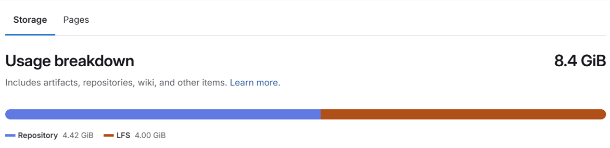
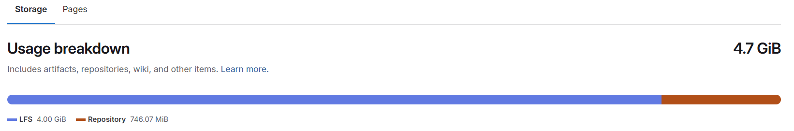

Today, I ran into an interesting issue with our GitLab infrastructure. A team had migrated a large number of repositories containing large files into GitLab, causing disk usage in our Gitaly cluster to grow significantly.

I had to identify which team and repositories were responsible, figure out where the storage was being consumed, and then find a way to reduce repository size without losing any files.

Here is how I investigated and resolved the issue.

## Finding the source of the problem

My first step was to identify which groups were consuming the most storage.

I went to the GitLab Admin Area and sorted groups by storage usage. This helped narrow the investigation to groups with unusually high storage consumption.

However, GitLab project storage consists of several components: Repository, LFS, Build artifacts, Pipeline artifacts, etc.

Looking at total storage usage alone wasn't enough to identify the problem. I examined individual projects and compared their storage breakdowns to determine which component was responsible for the excessive usage.

Eventually, I found several repositories with unusually high repository storage but almost no storage in the other components, especially LFS. This was a strong indication that large files had been committed directly into Git history instead of being managed by Git LFS.

## Migrating large files to Git LFS

Git LFS (Large File Storage) is an extension that allows Git to manage large binary files more efficiently. Instead of storing the entire file content directly in the Git repository, Git stores a small pointer file that references the actual content stored separately in LFS storage.

Git LFS provides the `migrate` command to convert existing Git history. For example, I used the following commands to migrate selected file types or files under a specific directory:

```sh
git lfs migrate import --everything --include="*.zip,*.iso,*.mp4"
git lfs migrate import --everything --include="assets/**"
```

The `--include` option lets me specify which files to migrate.

**This operation rewrites Git history.** When large files are replaced with LFS pointer files, the Git trees and commit IDs change. After reviewing the rewritten refs and coordinating a quiet window, I force-pushed the branches and tags to GitLab:

```sh
# Force-push all branches
git push --force --all origin

# Force-push all tags
git push --force --tags origin
```

- `--force --all` updates all branch refs pushed by this command.
- `--force --tags` pushes tags and permits updating existing tag refs.

## Cleaning up old repository data

After successfully migrating the files and force-pushing the rewritten history, I still needed to reclaim disk space. I used GitLab's built-in repository housekeeping mechanism. 

1. Navigate to **Settings → General → Advanced** in the affected project.
2. Select **Run housekeeping**.
3. Wait at least 30 minutes.
4. Return to the same page.
5. Select **Prune unreachable objects**.

## Preventing this from happening again

Fixing the affected repositories solved the immediate problem, but I didn't want to repeat the same investigation in the future.

As a preventive measure, I configured GitLab's **Maximum push size (MiB)** setting under **Admin Area → Settings → General → Account and limit**. This helps prevent developers from accidentally pushing excessively large amounts of data into Git repositories.

## Update: The repository size did not decrease after housekeeping

After running housekeeping, some repositories did not show a reduction in
storage — the repository size remained the same. I found that hidden refs on the
server were still pointing to commits from before the LFS migration. Here is
how I identified those commits on Gitaly and removed them using GitLab's
repository cleanup.

1. **Find the repository path on Gitaly.**

   ```sh
   sudo grep '"grpc.request.glRepository":"project-<id>"' \
     /var/log/gitlab/gitaly/current | head -n 1
   ```

   In the log entry, find `grpc.request.repoPath`. For example:
   `@cluster/repositories/18/af/22347`. The repo path is `/var/opt/gitlab/git-data/repositories/@cluster/repositories/18/af/22347`

2. **List the commits in `refs/keep-around`.** These refs are not shown when
   you clone the repository, even with `--mirror`.

3. Check each commit hash to find the old pre-LFS commits. Those commits
   should not be attached to any active branch.

   ```sh
   git --git-dir="<repository-path>" log --no-walk --oneline <commit hashes>
   ```

   The `--git-dir` option skips the `safe.directory` ownership check.
  
   Also check packed-refs for any additional hidden refs (keep-around, pipelines, merge-requests) 
   ```sh
   grep -E "keep-around|pipelines|merge-requests" <repository-path>/packed-refs
   ```

4. **Prepare a commit map** for GitLab repository cleanup, listing the old
   commit IDs in the first column and the all-zero hash in the second column:

   ```text
   <old-commit-id> 0000000000000000000000000000000000000000
   ```

   Use the full commit IDs. Check that the commits are no longer needed before
   including them in the map.

5. **Run GitLab repository cleanup.** Upload the commit map under **Settings →
   Repository → Repository maintenance → Clean up repository**, then select
   **Start cleanup**. Once cleanup was complete, the repository size
   decreased.

The screenshots show the project storage breakdown before and after cleanup:
repository storage decreased from 4.42 GiB to about 746 MiB, while LFS storage
remained at 4.00 GiB.

Before:



After:


